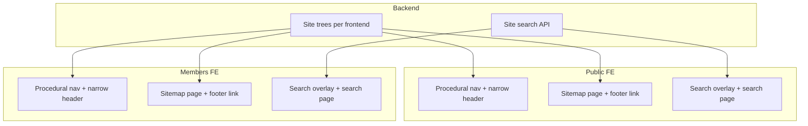

# v5.0.2 Navigation Wave

Date: 2026-11-15 (America/Chicago). Skill: `backlog-grooming`. Kaneo project **GSSC 5.0**. Tag **`v5.0.1`** is on master; this wave targets **Fix Version `v5.0.2`**.

## Owner architecture

- Backend stores a **page tree per frontend**; root = home (public) / dashboard (members).
- Top-level children = nav menu labels; deeper children = hover dropdowns; FE shows **at most two submenu levels**.
- Nav bars are **procedural from backend tree data**. Backend **does not drive Angular routing** — menus only.
- **Narrow layout:** centered logo; search toggle left; hamburger right until the full navbar fits without wrapping. Colors not final (owner prototypes).
- Menus **sticky** with header; open submenus **overlay** content (no layout shift).
- Dedicated **sitemap page** per site; **footer** link.
- **Search:** toggle opens overlay (entry + quick results → navigate); submit → dedicated search page with richer filters.

### Grooming defaults (locked unless owner overrides)

- Site tree **seed + admin-capable CRUD API**; **no** Members tree-editor UI in v5.0.2.
- Search corpus: tree labels/paths + section header/body + catalogs (pubs/tools/newsletters/events/announcements); members also directory display names when permitted.
- Integration suite: **Playwright** under `gssc5-web`, smoke for public + members chrome/nav/search.

## Existing tickets refined (not duplicated)

| Ticket | Prior | Wave action |
| --- | --- | --- |
| **GSSC5-40** | Planned; trees **and routes** | Menu data only; Public **and** Members trees; Fix **v5.0.2** |
| **GSSC5-41** | Planned Site Tree page | **Sitemap** + footer link; Fix **v5.0.2** |
| **GSSC5-45** | Ready nav module | Procedural nav + narrow/hamburger; **Not Ready** until **40** Done |
| **GSSC5-47** | Planned search widget | Overlay + search page; blocked by **106** |

## Matrix

| Ticket | Title | modify\|create | Column | DoR Sat | Depends | Scope |
| --- | --- | --- | --- | --- | --- | --- |
| **GSSC5-105** | v5.0.2 Navigation / Search / Integration (parent) | create | Not Ready | false | — | Wave parent |
| **GSSC5-40** | Backend Site Trees API | modify | Not Ready | false | reqs | Trees + seed + GET (+ admin write); no routing |
| **GSSC5-106** | Backend Site Search API | create | Not Ready | false | reqs | Quick + full search results |
| **GSSC5-110** | Integration Test Suite (Playwright) | create | Not Ready | false | harness DoR | Scaffold + CI + smoke |
| **GSSC5-45** | Public Navigation + Narrow Header | modify | Not Ready | false | **40** | Procedural nav; hamburger; sticky overlays |
| **GSSC5-41** | Public Sitemap Page | modify | Not Ready | false | **40** | Sitemap + footer link |
| **GSSC5-47** | Public Site Search | modify | Not Ready | false | **106** | Overlay + search page |
| **GSSC5-107** | Members Navigation + Narrow Header | create | Not Ready | false | **40** | Members procedural nav + narrow |
| **GSSC5-108** | Members Sitemap Page | create | Not Ready | false | **40** | Members sitemap + footer |
| **GSSC5-109** | Members Site Search | create | Not Ready | false | **106** | Members overlay + search page |

## Start order

1. After leaf DoR (HLR/LLR drafted): parallel **40**, **106**, **110**.
2. After **40** Done: parallel **45**, **41**, **107**, **108**.
3. After **106** Done: parallel **47**, **109**.
4. **110** expands smoke as chrome/search land (does not block FE leaves).

## DoR / DoD templates

**DoR:** Owner architecture accepted; Fix Version **v5.0.2**; blockers Done; in-scope HLR/LLR drafted or UIDs listed; labels set; Implementation empty until PR.

**DoD:** Scope on master; tests pass; closeout PASS where required; Fix Version **v5.0.2**; DoD Satisfied true.

**Parent DoD:** Leaves Done or owner-deferred; tag **v5.0.2** at release cut.

## Deferred

- Members site-tree editor UI
- Backend-driven Angular route registration
- Donate header control
- Copyright / social footer polish
- Cemetery / War Veterans product search

## Prototypes

Colors are not final.

| Layout | Image |
| --- | --- |
| Narrow header (closed) | [prototypes/narrow-header-closed.png](./prototypes/narrow-header-closed.png) |
| Narrow header (menu open) | [prototypes/narrow-header-menu-open.png](./prototypes/narrow-header-menu-open.png) |
| Wide header | [prototypes/wide-header.png](./prototypes/wide-header.png) |
| Wide nav + dropdown | [prototypes/wide-nav-dropdown.png](./prototypes/wide-nav-dropdown.png) |
